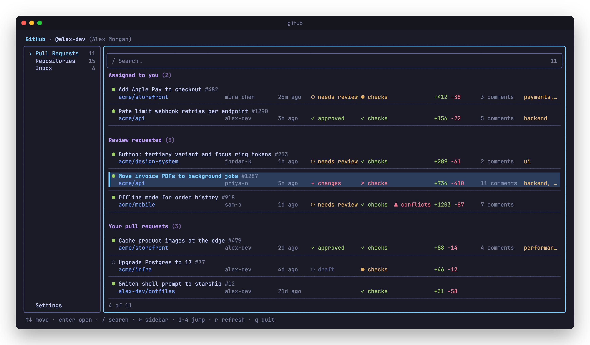
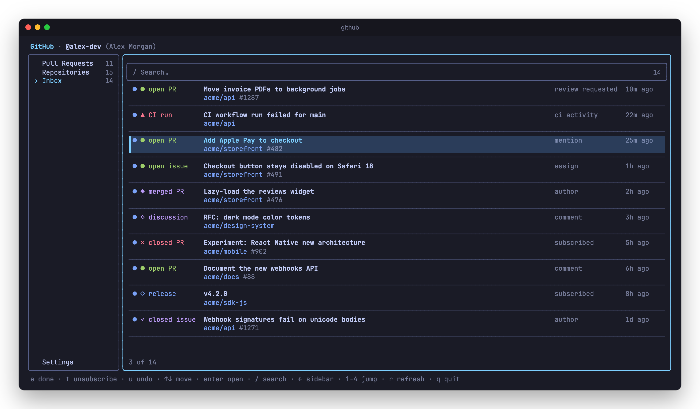
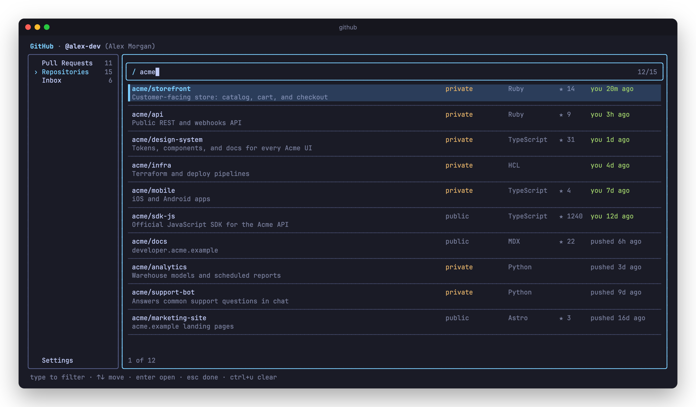
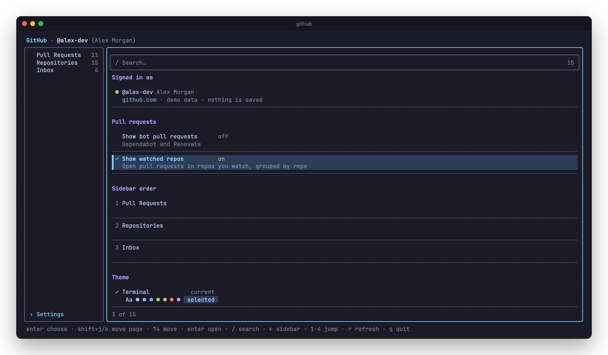

# github-tui

A terminal UI for your GitHub pull requests, repos, and notifications. Run `github`.

The app uses your `gh` login and never stores a token: it asks `gh auth token` each time it starts. Data is cached in `~/.cache/github-tui` so the app opens instantly, then refreshes.

**Pull requests** you're assigned, asked to review, or wrote, then open PRs in repos you watch. Status, checks, conflicts, and size line up in columns.



**Inbox** mirrors your GitHub notifications, with whether each PR or issue is open, merged, or closed. Mark done (`e`), unsubscribe (`t`), or undo (`u`) from the keyboard.



**Repositories** you can access, sorted by your own recent activity. Press `/` to search on any page.



**Settings** shows who you're signed in as and lets you pick a color theme: Terminal (your terminal's own colors), Cobalt2, Dracula, Nord, Solarized Dark, Gruvbox Dark, Tokyo Night, Lumon, or GitHub Light. It also lets you show bot pull requests (Dependabot and Renovate, hidden by default), hide the watched-repo groups on the Pull requests page, ask how to open a pull request (see below), and reorder the sidebar with `shift+j` and `shift+k`. The top sidebar page opens first. Your choices are saved to `~/.config/github-tui/settings.json` (or `$XDG_CONFIG_HOME/github-tui`). Themes look best in a terminal with 24-bit color.



**Open in slice.** Turn on "Ask to open in slice" in Settings. Then `enter` on a pull request asks where to open it: `s` reviews the diff in the terminal with [slice](https://github.com/gavinomelia/slice), and `g` opens GitHub. Install slice with `npm install -g @gavinomelia/slice`. The app runs `slice <PR URL>` from an empty git folder in `~/.cache/github-tui/slice`, so you don't need a local clone. Quit slice with `q` to come back. slice's AI review (`--ai`) isn't offered, because it needs a clone of the repo.

> Screenshots use made-up data. Run `github --demo` to try the UI without touching your account.

## Install

### 1. Install the requirements

You need **Node 22 or newer** and the **GitHub CLI** (`gh`).

On macOS with Homebrew:

```bash
brew install node gh
```

Check the versions:

```bash
node --version
gh --version
```

Using nodenv, nvm, or asdf for Node is fine. Make sure your default version is 22 or newer.

### 2. Log in to GitHub

```bash
gh auth login
```

Pick **GitHub.com**, then follow the prompts. If `gh auth status` already shows you as logged in, skip this step.

### 3. Install github-tui

```bash
npm install -g @jeremywalton/github-tui
```

With nodenv, nvm, or asdf, global npm packages belong to one Node version. Run the install from your home folder (`cd ~` first) so it goes into your default version. A project folder that pins a different Node version won't find the `github` command.

### 4. Run it

```bash
github
```

### From source

To run your own checkout instead:

```bash
git clone https://github.com/Jeremy-Walton/github-tui.git
cd github-tui
bin/install
```

`bin/install` installs dependencies, builds the app, and links a `github` command into `~/.local/bin`. With nodenv, that command always runs on your global Node version, so it works in any project folder. If it prints a line to add to your shell profile, add it to `~/.zshrc` (or `~/.bashrc`), then open a new terminal:

```bash
export PATH="$HOME/.local/bin:$PATH"
```

## Update

```bash
npm install -g @jeremywalton/github-tui
```

From source: `git pull`, then `bin/install`.

## Uninstall

```bash
npm uninstall -g @jeremywalton/github-tui
rm -r ~/.cache/github-tui ~/.config/github-tui
```

From source: `rm ~/.local/bin/github`, then delete the cloned folder.

## Troubleshooting

| Message | Fix |
| --- | --- |
| `github: command not found` | Installed with npm: your current folder uses a different Node version than the one you installed into. See step 3. From source: `~/.local/bin` is not on your PATH. |
| `github` opens GitHub Desktop | GitHub Desktop's command line tool is also named `github`. Put npm's bin folder (`npm prefix -g`/bin) or `~/.local/bin` earlier in your PATH. |
| `The GitHub CLI is not installed` | Install `gh` (step 1). |
| `Not logged in to GitHub` | Run `gh auth login` (step 2). |
| `github-tui needs Node 22 or newer` | Upgrade Node, or set a newer default in your version manager. |
| Inbox or org repos are empty | Your `gh` login needs the `repo` and `read:org` scopes. Run `gh auth refresh -s repo,read:org`. |

## Keys

| Key | Action |
| --- | --- |
| `↑` `↓` / `j` `k` | Move |
| `enter` | Open in browser, or ask GitHub or slice for a pull request when that setting is on (Settings: use the selected theme or switch the selected option) |
| `/` | Focus search (`esc` to leave, `esc` again to clear) |
| `←` / `h`, `tab` | Focus sidebar |
| `1` `2` `3` `4` | Jump to a page, in sidebar order |
| `shift+j` `shift+k` | Settings: move the selected sidebar page down or up |
| `r` | Refresh current page |
| `e` | Inbox: mark done |
| `t` | Inbox: unsubscribe (also marks done) |
| `u` | Inbox: undo the last done/unsubscribe (within 15 seconds) |
| `q` | Quit |

## Development

```bash
npm install
npm run dev
```

`npm run dev -- --demo` runs on made-up data from `src/demo.ts`. Demo mode makes no GitHub calls, doesn't open links, and doesn't read or write the cache or settings.

| Command | What it does |
| --- | --- |
| `npm run check` | Everything below, plus a scan for GitHub tokens. CI runs this on every push. |
| `npm run typecheck` | Strict TypeScript over `src/` and `test/` |
| `npm run lint` | Biome lint and format check |
| `npm run format` | Biome safe fixes and formatting |
| `npm test` | Vitest: unit tests, the GitHub client with stubbed responses, and the app rendered on demo data |

### Releasing

Pushing a `v*` tag publishes to npm through `.github/workflows/release.yml`. It runs `npm run check`, stops if the tag doesn't match the `package.json` version, then runs `npm publish --provenance`. It needs no npm token, because npm trusts the workflow (trusted publishing).

```bash
npm version patch   # or minor / major: bumps package.json, commits, and tags
git push --follow-tags
```

The first version must be published by hand, because trusted publishing is set up on a package that already exists:

1. `npm login`, then `npm publish` from a clean checkout of `main`.
2. On npmjs.com, open the package's settings and add a trusted publisher: GitHub Actions, repository `Jeremy-Walton/github-tui`, workflow `release.yml`.

### Screenshots

`npm run screenshots` builds the app and remakes the images in `docs/screenshots/` from demo mode. It needs `python3` and Google Chrome. Set `CHROME_PATH` if Chrome is somewhere else.

Claude Code hooks in `.claude/settings.json` run these for you. After each edit, the changed file is formatted and linted and the project is typechecked. When Claude finishes with uncommitted changes, `npm run check` runs, and failures go back to Claude.
